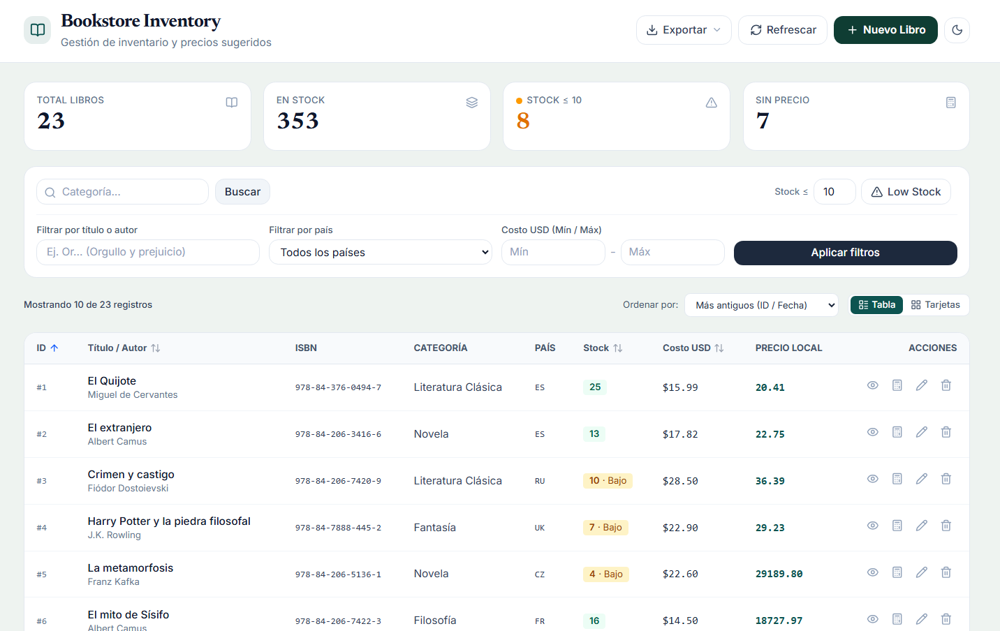
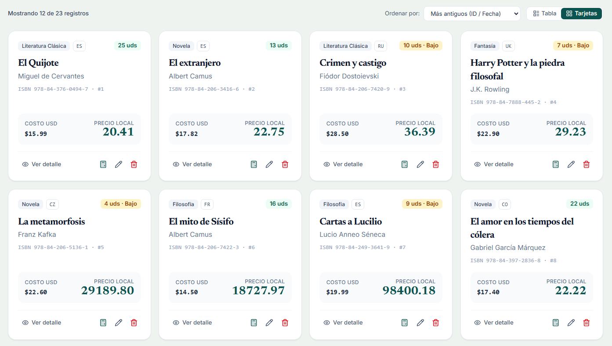
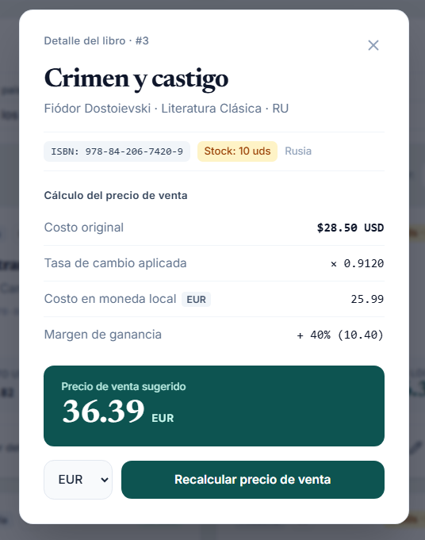
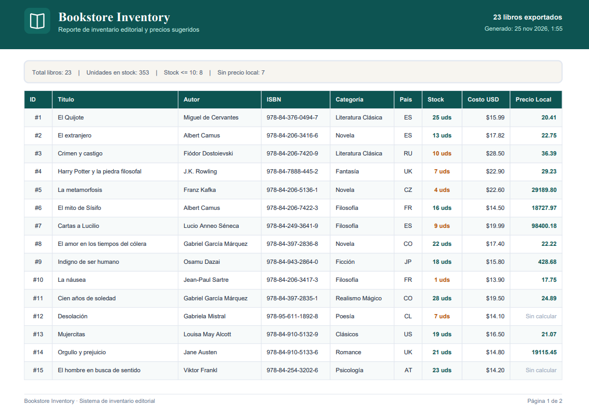

# Bookstore Inventory API & Dashboard


Sistema integral de gestión de inventario para librería compuesto por una **API REST en Django + Django REST Framework** y un **Dashboard interactivo en React + TypeScript + Vite**, con conversión automática de precios en tiempo real, persistencia de tasa de cambio y despliegue contenerizado con Docker.

> **Colección de Postman incluida:** Importa [`bookstore_api.postman_collection.json`](bookstore_api.postman_collection.json) en Postman (esquema v2.1) con la variable `{{base_url}}` (`http://localhost:8000`) y ejemplos JSON listos para probar los 9 endpoints de la API.

---

## Capturas

<table>
  <tr>
    <th width="50%">Dashboard — Vista Tabla</th>
    <th width="50%">Dashboard — Vista Tarjetas</th>
  </tr>
  <tr>
    <td width="50%" align="center" valign="middle">
      
    </td>
    <td width="50%" align="center" valign="middle">
      
    </td>
  </tr>
  <tr>
    <th width="50%">Calculadora y Detalle del Libro</th>
    <th width="50%">Reporte PDF Exportado</th>
  </tr>
  <tr>
    <td width="50%" align="center" valign="middle">
      
    </td>
    <td width="50%" align="center" valign="middle">
      
    </td>
  </tr>
</table>

---

## 1. Funcionalidades Principales

- **CRUD completo de libros con validaciones de negocio:**
  - Validación de formato **ISBN-10 / ISBN-13** (ignorando guiones y espacios) y unicidad en base de datos.
  - Validación de `cost_usd > 0` y `stock_quantity >= 0`.
- **Cálculo de precio de venta en tiempo real:** Conversión de `cost_usd` a moneda local (`EUR`, `VES`, `USD`, `GBP`, `MXN`, `COP`, entre otras) mediante `exchangerate-api.com`, aplicando un margen fijo del **40%** y **fallback seguro** ante fallos o timeouts de red.
- **Búsqueda y alertas de inventario:** Filtrado por categoría (`GET /books/search?category=...`) y detección de stock bajo configurable (`GET /books/low-stock?threshold=...`).
- **Dashboard en React:**
  - Vistas intercambiables de **Tabla** y **Tarjetas**, ordenamiento (por defecto desde el registro más antiguo), métricas KPI y filtros combinables.
  - **Modo claro / modo oscuro** persistente.
  - **Exportación** del catálogo filtrado a **PDF** (con formato corporativo Bookstore Inventory), **Excel (`.xlsx`)** con columnas autoajustadas y **CSV** (delimitado por `;`).
- **Catálogo inicial precargado:** Fixture [`books/fixtures/initial_books.json`](books/fixtures/initial_books.json) con **23 libros** listos para cargar automáticamente al iniciar Docker o de forma manual con `loaddata`.

---

## 2. Arquitectura y Stack Tecnológico

| Capa | Tecnología | Detalles |
|---|---|---|
| **Backend** | Python 3.12 · Django 6 · Django REST Framework | Arquitectura modular: `models.py`, `serializers.py`, `services.py`, `views.py`, `urls.py` |
| **Frontend** | React · TypeScript · Vite · Tailwind CSS | SPA responsiva con `lucide-react`, `jspdf`, `jspdf-autotable` y `xlsx` (SheetJS) |
| **Base de datos** | SQLite | Configurable mediante variable de entorno `DB_PATH` (volumen persistente `/app/data` en Docker) |
| **Contenedores** | Docker · Docker Compose | Build multi-stage para frontend (`node:20-alpine` → `nginx:alpine`) y backend (`python:3.12-slim`) |
| **Pruebas** | `rest_framework.test.APITestCase` + `unittest.mock` | Suite de **17 pruebas** unitarias e integración sin dependencia de internet |

---

## 3. Lógica de Negocio y Cálculo de Precios

Al invocar `POST /books/{id}/calculate-price`, el servicio [`books/services.py`](books/services.py) ejecuta el siguiente flujo:

1. Consulta la tasa de cambio vigente `USD -> currency` (por defecto `EUR`) en `https://api.exchangerate-api.com/v4/latest/USD` con timeout de 5 segundos.
2. Convierte el costo original a moneda local y aplica un **margen de ganancia fijo del 40%** (`ROUND_HALF_UP` a 2 decimales):

$$\text{cost\_local} = \text{cost\_usd} \times \text{exchange\_rate}$$

$$\text{selling\_price\_local} = \text{cost\_local} \times 1.40$$

3. **Persistencia en base de datos:** Guarda en el modelo `Book` tanto `selling_price_local` como `price_currency` y `price_exchange_rate`, permitiendo consultar el desglose completo en el modal de detalle incluso tras recargar la página.
4. **Manejo de fallback:** Si la API externa falla, tarda más de 5 segundos o no soporta la moneda, el sistema registra una advertencia en logs y aplica `FALLBACK_RATES` (`EUR: 0.85`, `VES: 45.00`, `USD: 1.00`), devolviendo `used_fallback: true` sin interrumpir la operación (`200 OK`).

---

## 4. Guía de Instalación y Despliegue

### Requisitos previos
- **Opción A (Docker):** Docker Desktop / Docker Engine con Docker Compose v2.
- **Opción B (Local):** Python **3.12+** y Node.js **20+**.

### Opción A: Despliegue con Docker (Recomendado)

1. Construir y levantar ambos servicios (aplica migraciones y carga automáticamente los 23 libros iniciales):
   ```bash
   docker compose up --build
   ```
2. Acceder a las aplicaciones:
   - **Frontend (Dashboard):** http://localhost:5173
   - **Backend (API REST):** http://localhost:8000/books
3. Detener los contenedores:
   ```bash
   docker compose down
   ```

### Opción B: Ejecución en Local

1. **Backend (Django):**
   ```bash
   python -m venv venv
   # En Windows PowerShell:
   .\venv\Scripts\Activate.ps1
   # En Linux/macOS:
   # source venv/bin/activate

   pip install -r requirements.txt
   python manage.py migrate
   python manage.py loaddata books/fixtures/initial_books.json
   python manage.py runserver 0.0.0.0:8000
   ```

2. **Frontend (React + Vite):** en otra terminal:
   ```bash
   cd frontend
   npm install
   npm run dev
   ```
   Disponible en `http://localhost:5173`.

3. **Ejecutar la suite de pruebas automatizadas:**
   ```bash
   python manage.py test -v 2
   ```

---

## 5. Documentación de Endpoints de la API

Base URL por defecto: `http://localhost:8000` (rutas configuradas sin barra final obligatoria).

| Método | Endpoint | Descripción | Códigos HTTP |
|---|---|---|---|
| `POST` | `/books` | Crea un nuevo libro | `201`, `400` |
| `GET` | `/books` | Lista libros paginados (`10` por página) | `200` |
| `GET` | `/books/{id}` | Obtiene el detalle de un libro | `200`, `404` |
| `PUT` | `/books/{id}` | Actualiza todos los campos de un libro | `200`, `400`, `404` |
| `PATCH` | `/books/{id}` | Actualización parcial (ej. `stock_quantity`) | `200`, `400`, `404` |
| `DELETE` | `/books/{id}` | Elimina un libro del inventario | `204`, `404` |
| `GET` | `/books/search?category=...` | Filtra por categoría (insensible a mayúsculas) | `200`, `400` |
| `GET` | `/books/low-stock?threshold=10` | Lista libros con `stock_quantity <= threshold` | `200`, `400` |
| `POST` | `/books/{id}/calculate-price` | Calcula y persiste el precio local (+40%) | `200`, `404`, `500` |

### Ejemplos con `curl` y respuestas JSON

#### 1. Crear libro (`POST /books`)
```bash
curl -X POST http://localhost:8000/books \
  -H "Content-Type: application/json" \
  -d '{
    "title": "El nombre de la rosa",
    "author": "Umberto Eco",
    "isbn": "978-84-264-1547-9",
    "cost_usd": 21.50,
    "stock_quantity": 14,
    "category": "Filosofía",
    "supplier_country": "IT"
  }'
```
**Respuesta (`201 Created`):**
```json
{
  "id": 24,
  "title": "El nombre de la rosa",
  "author": "Umberto Eco",
  "isbn": "978-84-264-1547-9",
  "cost_usd": "21.50",
  "selling_price_local": null,
  "price_currency": null,
  "price_exchange_rate": null,
  "stock_quantity": 14,
  "category": "Filosofía",
  "supplier_country": "IT",
  "created_at": "2026-11-25T05:00:00.000000Z",
  "updated_at": "2026-11-25T05:00:00.000000Z"
}
```

#### 2. Listar libros (`GET /books`) / Buscar (`GET /books/search?category=Filosofía`) / Stock bajo (`GET /books/low-stock?threshold=10`)
```bash
curl http://localhost:8000/books
curl "http://localhost:8000/books/search?category=Filosof%C3%ADa"
curl "http://localhost:8000/books/low-stock?threshold=10"
```
**Respuesta paginada (`200 OK`):**
```json
{
  "count": 1,
  "next": null,
  "previous": null,
  "results": [
    {
      "id": 1,
      "title": "El Quijote",
      "author": "Miguel de Cervantes",
      "isbn": "978-84-376-0494-7",
      "cost_usd": "15.99",
      "selling_price_local": "20.41",
      "price_currency": "EUR",
      "price_exchange_rate": "0.912000",
      "stock_quantity": 25,
      "category": "Literatura Clásica",
      "supplier_country": "ES",
      "created_at": "2026-11-25T01:22:27.701000Z",
      "updated_at": "2026-11-25T04:50:42.426000Z"
    }
  ]
}
```

#### 3. Obtener (`GET /books/{id}`), Actualizar (`PUT`/`PATCH /books/{id}`) y Eliminar (`DELETE /books/{id}`)
```bash
curl http://localhost:8000/books/1

curl -X PATCH http://localhost:8000/books/1 \
  -H "Content-Type: application/json" \
  -d '{"stock_quantity": 12}'

curl -X DELETE http://localhost:8000/books/1
```

#### 4. Calcular precio local (`POST /books/{id}/calculate-price`)
```bash
curl -X POST http://localhost:8000/books/1/calculate-price \
  -H "Content-Type: application/json" \
  -d '{"currency": "EUR"}'
```
**Respuesta (`200 OK`):**
```json
{
  "book_id": 1,
  "cost_usd": 15.99,
  "exchange_rate": 0.912,
  "cost_local": 14.58,
  "margin_percentage": 40,
  "selling_price_local": 20.41,
  "currency": "EUR",
  "used_fallback": false,
  "calculation_timestamp": "2026-11-25T04:50:42.426000Z"
}
```

---

## 6. Estructura del Código Fuente

```text
bookstore-inventory-api/
├── books/
│   ├── fixtures/
│   │   └── initial_books.json          # Catálogo inicial (23 libros)
│   ├── migrations/                     # Migraciones de Django
│   ├── admin.py
│   ├── apps.py
│   ├── models.py                       # Modelo Book
│   ├── serializers.py                  # Validaciones ISBN, cost_usd y stock_quantity
│   ├── services.py                     # Integración API de tasas + margen 40% + fallback
│   ├── tests.py                        # Suite de 17 pruebas automatizadas (APITestCase)
│   ├── urls.py                         # Router DRF (trailing_slash=False)
│   └── views.py                        # BookViewSet + search, low-stock, calculate-price
├── config/
│   ├── asgi.py
│   ├── settings.py                     # Configuración Django, CORS, DRF y DB_PATH
│   ├── urls.py
│   └── wsgi.py
├── frontend/
│   ├── src/
│   │   ├── api/                        # Cliente HTTP (booksApi.ts)
│   │   ├── components/                 # Modales, grilla de tarjetas, selectores, toasts
│   │   ├── types/                      # Interfaces TypeScript (book.ts)
│   │   ├── utils/                      # Países y exportadores CSV / Excel / PDF
│   │   ├── App.tsx
│   │   ├── index.css
│   │   └── main.tsx
│   ├── Dockerfile                      # Multi-stage Node 20 -> Nginx Alpine
│   └── package.json
├── .dockerignore
├── .gitignore
├── bookstore_api.postman_collection.json
├── docker-compose.yml
├── Dockerfile                          # Backend Python 3.12-slim
├── manage.py
├── README.md
└── requirements.txt
```
